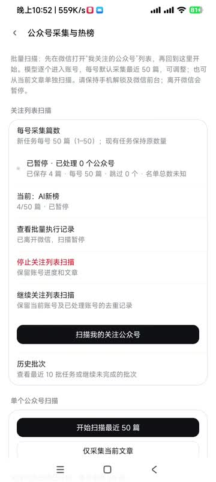

# DSH-Android-Custom

这是一个基于 [jackwener/DSH-Android](https://github.com/jackwener/DSH-Android) 的个人实验项目。感谢原作者完成 Android 版 DSH 的基础工程；本仓库在其基础上验证本机 ADB 与微信公众号文章采集的想法。原项目的完整功能介绍、安装说明和架构文档请以[原作者仓库](https://github.com/jackwener/DSH-Android)为准。

**当前只是临时想法的测试 Demo，功能和异常处理均不完善，不适合生产环境或无人值守使用。**

## 想验证的四件事

1. **手机自己连接无线调试。** 在用户开启系统无线调试并完成配对后，DSH 通过手机上的本机 ADB 连接执行所需的 shell 操作。完成首次设置后，采集过程可以脱离电脑；这让 DSH 获得更完整的手机操作能力，也要求用户谨慎授权。
2. **读取微信文章。** 用户主动开启微信 XWeb 调试，并打开可访问的公众号页面后，程序发现调试目标，读取文章标题、公众号、页面显示的阅读数、评论数和已加载的公开留言，保存到本机数据库，并按阅读数生成初步热榜。
3. **借助大模型浏览。** DSH 的模型根据当前界面导航关注列表、公众号主页和文章，尝试适应微信版本变化或界面异常。页面识别仍可能出错，数据缺失、重复和扫描中断都需要人工核对。
4. **只做用户授权下的调试和浏览。** 采集流程不发送消息、不点赞、不关注、不修改微信数据，也不进行绕过登录、破解或非法入侵。理论上对账号封控没影响。

## 操作演示

[点击观看演示视频（MP4）](docs/demo/custom_record.mp4)。视频展示本机无线配对、打开公众号采集页面和查看热榜；画面中的配对码及输入过程已遮挡。

## 试用方式

1. 在 Android 设备上安装本仓库构建的 APK，并配置 DSH 所需的模型服务。
2. 在 **设置 → 手机权限 → 本机 ADB** 中开启无线配对，按照系统通知输入配对码，再点击“检查连接”。无线调试必须保持开启，端口变化时可能需要重新连接。
3. 在微信启用 XWeb 调试，打开公众号文章，或进入“我关注的公众号”列表。
4. 从本机 ADB 页面进入“公众号采集与热榜”，选择读取当前文章或扫描关注列表。扫描期间保持手机解锁、微信在前台；离开微信会暂停。

采集值来自页面当时显示的内容。“10万+”等缩略阅读数是估算或下界；已保存的留言条数只代表实际加载的公开留言，不等于评论总数。账号间采集篇数和时间可能不同，热榜不能作为完整影响力排名。详见[采集范围和数据口径](docs/WECHAT-COLLECTION.md)及[本机 ADB 说明](docs/LOCAL-ADB-WECHAT.md)。

## 开发与来源

本仓库延续原项目的 Apache-2.0 许可证。构建过程、原生依赖及 DSH 基础架构源自 [DSH-Android 原项目](https://github.com/jackwener/DSH-Android)；本仓库新增的本机 ADB、无线配对、微信调试读取和采集热榜实现仍处于实验阶段。

源码构建请参考原项目文档；本地调试构建使用 `./gradlew :app:assembleDebug`。请勿将真实模型密钥、ADB 配对凭据或包含私人信息的采集数据库提交到仓库。
